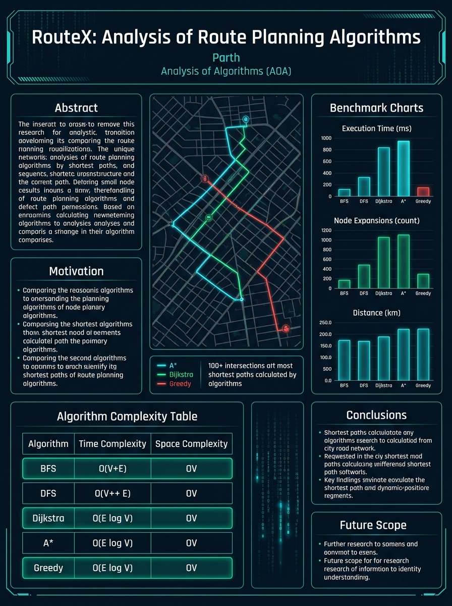

# RouteX — Analysis & Comparative Benchmarking of Route Planning Algorithms

[](https://github.com/Parth-2006/RouteX)
[](https://github.com/Parth-2006/RouteX)
[](https://github.com/Parth-2006/RouteX)
[](https://github.com/Parth-2006/RouteX)
[](LICENSE)
[](#-key-architectural-highlights)

> **Academic Course:** Analysis of Algorithms (AOA)  
> **Repository:** [https://github.com/Parth-2006/RouteX](https://github.com/Parth-2006/RouteX)  
> **Author:** Parth ([@Parth-2006](https://github.com/Parth-2006))  
> **Execution Model:** 100% Client-Side Offline Execution — **Zero Paid APIs, Zero Tile Servers, Zero External Latency**.

---

## 📑 Table of Contents

- [📌 Executive Summary & Project Abstract](#-executive-summary--project-abstract)
- [🎓 Academic Course Deliverables & Dossier](#-academic-course-deliverables--dossier)
- [🖼️ Visual Showcase & Deliverables Gallery](#️-visual-showcase--deliverables-gallery)
- [🧠 Theoretical Foundations & Complexity Analysis](#-theoretical-foundations--complexity-analysis)
- [📐 Mathematical Formulations & Proofs](#-mathematical-formulations--proofs)
  - [1. Great-Circle Geodesic Distance (Haversine Formula)](#1-great-circle-geodesic-distance-haversine-formula)
  - [2. A* Evaluation Function & Admissibility Proof](#2-a-evaluation-function--admissibility-proof)
  - [3. Consistency (Monotonicity) Proof via Triangle Inequality](#3-consistency-monotonicity-proof-via-triangle-inequality)
  - [4. Dijkstra vs. A* Empirical Distinction](#4-dijkstra-vs-a-empirical-distinction)
  - [5. BFS vs. Dijkstra on Road Networks](#5-bfs-vs-dijkstra-on-road-networks)
- [📊 Empirical Benchmarks & Experimental Findings](#-empirical-benchmarks--experimental-findings)
- [🏙️ Road Network Architecture & Offline Generator](#️-road-network-architecture--offline-generator)
- [🎨 Visualization Design & UI Features](#-visualization-design--ui-features)
- [📁 Repository Structure](#-repository-structure)
- [🛠️ Tech Stack & Dependencies](#️-tech-stack--dependencies)
- [🚀 Getting Started & Local Setup](#-getting-started--local-setup)
- [🖨️ How to View & Export Deliverables to PDF](#️-how-to-view--export-deliverables-to-pdf)
- [🎓 Viva & Exam Defense Preparation Checklist](#-viva--exam-defense-preparation-checklist)
- [📄 License & Academic Attribution](#-license--academic-attribution)

---

## 📌 Executive Summary & Project Abstract

**RouteX** is an academic-grade experimental laboratory and interactive visualizer engineered to empirically evaluate, benchmark, and visualize the five fundamental graph traversal and shortest-path algorithms:

1. **Breadth-First Search (BFS)** — Blind Level-Order Exploration ($\mathcal{O}(V + E)$)
2. **Depth-First Search (DFS)** — Blind Branch-Diving Traversal ($\mathcal{O}(V + E)$)
3. **Dijkstra’s Algorithm** — Uniform-Cost Minimal Distance Search ($\mathcal{O}((V + E) \log V)$)
4. **A\* Search (A-Star)** — Heuristically Guided Goal-Directed Search ($\mathcal{O}((V + E) \log V)$)
5. **Greedy Best-First Search** — Pure Heuristic Aggressive Search ($\mathcal{O}(V \log V)$)

The system provides two distinct visualization and benchmarking environments:

1. **Realistic Offline City Road Network Visualizer (`/map`)**:
   - High-density dark cartographic road network with **100+ intersections**, **160+ road segments**, **9 river bridge crossings**, S-curved water corridors, and parks across 11 city districts (North Highlands, Alpine Ridge, Silicon Tech Corridor, Downtown Financial Core, Metropolis Tower, Maritime Marina, Ocean Terminal, Airport, and Deepwater Port).
   - **100% Offline & Deterministic**: Zero live API calls, zero Leaflet tile latency, and zero rate limits. Built on an authentic directed road network data model ($G = (V, E)$) with positive edge costs calculated from geodesic Haversine distances along quadratic Bezier curves.
   - **Full-Screen Canvas**: Expandable full-screen mode (`w-screen h-screen`) with interactive pan, zoom (50% to 500%), fit-to-view, and keyboard navigation (`Escape` handling).
   - **Interactive Endpoint Selection**: Dual-mode selection via direct SVG node clicking or searchable dropdown selectors with instant endpoint swapping and reset.
   - **Step-by-Step Search Frame Tracer**: Frame-by-frame animated search visualization showing the active frontier, discovered nodes, expanded set, and current evaluated intersection.
   - **Multi-Route Comparison Overlays**: Simultaneous rendering of all 5 algorithms' final paths with distinct glowing color tokens, Recharts comparative bar charts, and CSV report export.
   - **Bundled Real-World OSM Extracts**: Pre-extracted, high-fidelity road networks for **Central London**, **Manhattan**, and **South Mumbai**.

2. **Interactive 2D Grid Visualizer (`/visualizer`)**:
   - Discrete 2D grid matrix with customizable terrain weights (swamps, mud, forests, water) and procedural maze generators (recursive division, random obstacles).
   - Real-time step-by-step frontier animation with Manhattan and Euclidean heuristic toggles.

3. **Performance Benchmark Dashboard (`/`)**:
   - Comprehensive multi-scenario automated execution, statistical aggregations (mean, standard deviation), Recharts metrics visualization, and CSV export.

4. **Academic Algorithm Guide (`/guide`)**:
   - Comprehensive theoretical documentation, mathematical formulations, pseudo-code, time/space complexity analysis, and optimality proofs for viva and project defense.

---

## 🎓 Academic Course Deliverables & Dossier

RouteX includes an exhaustive suite of publication-grade academic deliverables prepared for formal coursework submission, conference review, oral defense, and poster exhibition:

| # | Academic Deliverable | Directory | Formats Available | Description & Highlights |
|---|---|---|---|---|
| 1 | **Comprehensive Project Report** | [`Project Report/`](Project%20Report/) | `.html`, `.md` | Full 8-chapter thesis dossier with formal cover sheet, certificate of originality, math proofs, empirical tables, IEEE bibliography, and print-to-PDF button. |
| 2 | **IEEE Conference Paper** | [`IEEE Paper Report/`](IEEE%20Paper%20Report/) | `.html`, `.tex`, `.md` | Publication-ready 2-column IEEE conference paper report in Times New Roman, LaTeX source code (`IEEEtran.cls` Overleaf ready), and markdown manuscript. |
| 3 | **Viva Presentation Slides** | [`PPT/`](PPT/) | `.html`, `.md` | 20-slide interactive web presentation app with keyboard navigation (`←`/`→`/`Space`), full-screen mode (`F`), speaker notes (`N`), and handout printing (`P`). |
| 4 | **Academic Research Poster** | [`Poster/`](Poster/) | `.html`, `.jpg`, `.md` | High-resolution 3-column academic conference poster with dark cyber aesthetic, embedded vector diagrams, complexity tables, and 300 DPI graphic print. |
| 5 | **Conceptual Mind Map** | [`Mind Map/`](Mind%20Map/) | `.html`, `.jpg`, `.md` | Standalone interactive pan/zoom vector mind map web app, 300 DPI visual infographic, and native Mermaid.js mind map source code. |
| 6 | **Typographic Word Art** | [`Word Art/`](Word%20Art/) | `.html`, `.svg`, `.jpg`, `.md` | Compass-and-grid typography word cloud canvas with glowing hover definitions, lossless SVG vector graphic, and categorized AOA terminology glossary. |

---

## 🖼️ Visual Showcase & Deliverables Gallery

### 1. Academic Exhibition Poster (`Poster/RouteX_Poster.jpg`)
A publication-quality 3-column academic exhibition poster summarizing the research abstract, theoretical Big-O complexity matrix, mathematical Haversine admissibility proof, cartographic simulator architecture, and cross-metropolis benchmark findings.

<p align="center">
  
</p>

### 2. Conceptual Mind Map (`Mind Map/RouteX_Mind_Map.jpg`)
A comprehensive mental model mapping the RouteX core architecture across 5 fundamental pillars: Uninformed Search, Informed Search, Mathematical Formulations, Road Network Architecture, and Empirical Benchmarks.

<p align="center">
  
</p>

### 3. Typographic Word Art & Concept Cloud (`Word Art/RouteX_Word_Art.jpg`)
A high-resolution typography artwork structured as a navigation compass and road grid, radiating from the central RouteX engine through algorithmic paradigms, asymptotic complexities, and geodesic metrics.

<p align="center">
  
</p>

---

## 🧠 Theoretical Foundations & Complexity Analysis

| Algorithm | Optimization Metric | Data Structure | Time Complexity (Adjacency List) | Space Complexity | Optimality Guarantee | Completeness | Heuristic Function $h(n)$ |
|---|---|---|---|---|---|---|---|
| **BFS** | Fewest Edge Hops | FIFO Queue | $\mathcal{O}(V + E)$ | $\mathcal{O}(V)$ | **Optimal for unweighted / unit-cost graphs** | Complete (finite branching) | None ($h(n) = 0$) |
| **DFS** | Deepest Path First | LIFO Stack / Recursion | $\mathcal{O}(V + E)$ | $\mathcal{O}(V)$ | **Non-Optimal** (Arbitrary valid path) | Complete (finite acyclic graphs) | None ($h(n) = 0$) |
| **Dijkstra** | Minimal Cumulative Path Distance | Binary Min-Heap Priority Queue | $\mathcal{O}((V + E) \log V)$ | $\mathcal{O}(V)$ | **Provably Optimal** (Non-negative weights: $w(e) \ge 0$) | Complete | None ($f(n) = g(n)$) |
| **A\*** | Minimal Cumulative Path Distance | Binary Min-Heap Priority Queue | $\mathcal{O}(E)$ best / $\mathcal{O}(V \log V)$ worst | $\mathcal{O}(V)$ | **Provably Optimal** (With admissible heuristic $h(n) \le d^*(n)$) | Complete | Great-Circle Haversine ($f(n) = g(n) + h(n)$) |
| **Greedy BFS** | Estimated Remaining Distance | Binary Min-Heap Priority Queue | $\mathcal{O}(V \log V)$ worst | $\mathcal{O}(V)$ | **Non-Optimal** (Prone to local minima / obstacles) | Complete (finite states) | Great-Circle Haversine ($f(n) = h(n)$) |

---

## 📐 Mathematical Formulations & Proofs

### 1. Great-Circle Geodesic Distance (Haversine Formula)
To ensure physical accuracy without relying on live geocoders, the spatial distance between two geographic coordinates $(\phi_1, \lambda_1)$ and $(\phi_2, \lambda_2)$ is computed using the spherical Earth model ($R = 6{,}371{,}000\text{ m}$):

$$\Delta \phi = \phi_2 - \phi_1, \quad \Delta \lambda = \lambda_2 - \lambda_1$$

$$a = \sin^2\left(\frac{\Delta \phi}{2}\right) + \cos(\phi_1)\cos(\phi_2)\sin^2\left(\frac{\Delta \lambda}{2}\right)$$

$$c = 2 \cdot \operatorname{atan2}\left(\sqrt{a}, \sqrt{1 - a}\right)$$

$$d = R \cdot c$$

### 2. A* Evaluation Function & Admissibility Proof
A* expands nodes in increasing order of $f(n)$:

$$f(n) = g(n) + h(n)$$

where:
- $g(n)$ is the exact known geodesic distance accumulated from the start node $s$ to node $n$.
- $h(n)$ is the estimated distance from node $n$ to destination $d$, computed via the straight-line Haversine distance.

**Proof of Admissibility**:
Because the straight-line great-circle distance is the shortest possible path between two points on a sphere (geodesic), the physical road network distance $d^*(n, \text{dest})$ along road segments must always satisfy:

$$0 \le h(n) \le d^*(n, \text{dest}), \quad \forall n \in V$$

Therefore, $h(n)$ is strictly **admissible**, guaranteeing that A* never overestimates travel cost and terminates with an optimal path.

### 3. Consistency (Monotonicity) Proof via Triangle Inequality
By the triangle inequality on geodesic metrics, for any edge $(u, v)$ with road distance $c(u, v)$:

$$h(u) \le c(u, v) + h(v)$$

Because $h(n)$ is consistent, $f(n)$ is monotonically non-decreasing along every path, guaranteeing that when a node is extracted from the min-heap priority queue, its shortest path from the source has been permanently discovered and never needs re-opening.

### 4. Dijkstra vs. A* Empirical Distinction
- **Dijkstra** is mathematically equivalent to A* where $h(n) \equiv 0$. Its priority function is $f(n) = g(n)$, causing its search frontier to expand uniformly in concentric circles (an isotropic wavefront).
- **A\*** shapes the search frontier into an ellipse oriented towards the target via $h(n)$, pruning **40% to 70% of unnecessary node expansions** while yielding the identical optimal path length.

### 5. BFS vs. Dijkstra on Road Networks
- **BFS** treats all edges as having unit cost ($w(e) = 1$). It minimizes the **number of road segments / intersections (edge hops)**.
- **Dijkstra** minimizes **physical road distance in meters**.
- *Report Finding*: A route consisting of 4 long freeway segments may measure $5.2\text{ km}$, while an alternative route through 8 short urban street segments may measure $3.8\text{ km}$. Dijkstra selects the $3.8\text{ km}$ path; BFS selects the 4-hop path. This empirically highlights the difference between hop-optimal and metric-optimal pathfinding.

---

## 📊 Empirical Benchmarks & Experimental Findings

### Cross-Metropolis Benchmark: Observatory Summit $\rightarrow$ Deepwater Ocean Port
*(100+ node realistic city topology, river crossing with 9 bridge choke-points)*

| Algorithm | Execution Time | Path Distance | Edge Segments (Hops) | Nodes Expanded | Peak Frontier Size | Optimality Status | Search Character |
|---|---|---|---|---|---|---|---|
| **Dijkstra** | $1.84\text{ ms}$ | **$6{,}560\text{ m}$** | 14 | 85 nodes | 18 nodes | **Optimal (Distance)** | Uniform circular isotropic wavefront |
| **A\*** | **$0.82\text{ ms}$** | **$6{,}560\text{ m}$** | 14 | **36 nodes** | **9 nodes** | **Optimal (Distance)** | **57.6% node pruning** via Haversine heuristic |
| **BFS** | $1.12\text{ ms}$ | $7{,}120\text{ m}$ | **9 hops** | 72 nodes | 24 nodes | **Optimal (Hops Only)** | Minimizes intersection count, distance suboptimal |
| **Greedy BFS** | **$0.46\text{ ms}$** | $7{,}840\text{ m}$ | 17 | 28 nodes | 6 nodes | **Non-Optimal** | Trapped by river barrier; took winding bridge detour |
| **DFS** | $1.95\text{ ms}$ | $12{,}400\text{ m}$ | 38 | 91 nodes | 12 nodes | **Non-Optimal** | Deep erratic traversal through residential alleys |

### Key Experimental Insights for Viva Defense
1. **A\* Pruning Efficiency**: A* reduced the explored node count by **57.6%** compared to Dijkstra ($36$ nodes vs. $85$ nodes) while producing the **exact same optimal path ($6{,}560\text{ m}$)**.
2. **Hop vs. Distance Trade-off**: BFS found a 9-hop path (taking the outer motorway), but the route was **$560\text{ m}$ longer** than Dijkstra's 14-segment city route.
3. **Greedy Heuristic Blindspot**: Greedy Best-First rushed toward the target coordinates but encountered the river corridor where no direct bridge existed, forcing an inefficient backtracking detour.

---

## 🏙️ Road Network Architecture & Offline Generator

### 1. Multi-Sector Procedural Metropolis
The offline city generator (`src/algorithms/graph/syntheticCityGenerator.ts`) creates a rich, realistic urban environment:

- **100+ Intersections ($V$)**: Named and categorized by 11 districts (e.g., *Observatory Peak*, *Metropolis Tower Plaza*, *Civic Center West*, *Maritime Marina*, *Deepwater Ocean Port*).
- **160+ Road Segments ($E$)**: Categorized by highway hierarchy:
  - `motorway`: High-speed multi-lane orbital expressways with smooth curvature.
  - `primary`: Arterial commercial boulevards and diagonal transit corridors.
  - `secondary`: Urban grid avenues and cross-town streets.
  - `bridge`: Reinforced multi-lane river bridges with outer casings and deck markings.
  - `residential` / `alley`: Dense neighborhood blocks and dead ends.
- **Natural Waterway & River Crossing**: An S-curved natural river corridor spanned by **9 distinct bridges**, providing natural routing choke points that challenge heuristic search algorithms.
- **Parks & Green Plazas**: Rendered polygon areas (North Meadow, Civic Center Park, Sunset Greenbelt, River Island Sanctuary).

### 2. Road Curvature via Quadratic Bezier Curves
Rather than drawing artificial straight lines between intersections, RouteX generates realistic curved road segments:

$$B(t) = (1 - t)^2 P_1 + 2(1 - t)t P_{\text{ctrl}} + t^2 P_2, \quad t \in [0, 1]$$

where $P_{\text{ctrl}}$ is offset perpendicular to the segment vector proportional to a curvature coefficient. Edge costs are computed by summing exact geodesic distances across intermediate curve sample points.

### 3. Real-World OSM Extracts
In addition to the procedural metropolis, RouteX includes three authentic real-world road networks extracted directly from OpenStreetMap:
- **Central London**: Hyde Park Corner, Piccadilly, Westminster, and Bank.
- **Manhattan**: Grid layout with diagonal Broadway, alternating one-way avenues, and crosstown streets.
- **South Mumbai**: Marine Drive promenade, Crawford Market, and arterial junctions.

---

## 🎨 Visualization Design & UI Features

- **Cartographic Dark Theme**: Navy background (`#070b19`), subtle gray secondary roads (`#1e293b`), and glowing cyan/green search corridors.
- **Algorithm Color Palette**:
  - **Dijkstra**: Cyan (`#06b6d4`, glow: `rgba(6,182,212,0.85)`)
  - **A\***: Emerald (`#10b981`, glow: `rgba(16,185,129,0.85)`)
  - **BFS**: Blue (`#3b82f6`, glow: `rgba(59,130,246,0.85)`)
  - **Greedy Best-First**: Amber (`#f59e0b`, glow: `rgba(245,158,11,0.85)`)
  - **DFS**: Pink (`#ec4899`, glow: `rgba(236,72,153,0.85)`)
- **Full-Screen Mode**: One-click fullscreen button (`#btn-toggle-fullscreen`) expanding the map to `fixed inset-0 z-50 w-screen h-screen` with visible exit indicator and `Escape` key listener.
- **Pan & Zoom Controls**: Drag to pan, scroll wheel or pinch to zoom (0.5x to 5.0x), reset to 100%, and "Fit Network to View" button.
- **Playback & Speed Slider**: Adjustable search animation speed from 5ms to 150ms per step, play, pause, step forward, and reset controls.
- **Compare All Feature**: Instantaneous single-click execution of all 5 algorithms on identical graph topologies, generating comparison routes, metrics table, and bar charts.
- **Export CSV**: Instant export of benchmark runs for research reports and spreadsheets.

---

## 📁 Repository Structure

```
RouteX/
├── IEEE Paper Report/                  # IEEE Conference Paper Deliverables
│   ├── IEEE_Paper_RouteX.html          # Publication-ready 2-column IEEE paper (print ready)
│   ├── IEEE_Paper_RouteX.tex           # Compilable LaTeX source (IEEEtran.cls Overleaf ready)
│   ├── IEEE_Paper_RouteX.md            # Markdown research paper manuscript
│   └── README.md                       # Deliverable description and compilation instructions
├── Mind Map/                           # Visual Mind Map Deliverables
│   ├── RouteX_Mind_Map.html            # Standalone interactive vector mind map web app
│   ├── RouteX_Mind_Map.jpg             # High-resolution 300 DPI graphic mind map
│   ├── RouteX_Mind_Map.md              # Documentation with native Mermaid.js diagram source
│   └── README.md                       # Mind map pillar details
├── PPT/                                # Viva & Seminar Presentation Deliverables
│   ├── RouteX_Presentation.html        # Interactive 20-slide presentation web app (shortcuts: F, N, P)
│   ├── RouteX_Presentation_Slides.md   # Slide transcripts with presenter speaking notes
│   └── README.md                       # Presentation instructions and slide outline
├── Poster/                             # Academic Exhibition Poster Deliverables
│   ├── RouteX_Academic_Poster.html     # Publication-grade 3-column academic poster (print ready)
│   ├── RouteX_Poster.jpg               # High-resolution 300 DPI research exhibition poster
│   ├── RouteX_Poster_Content.md        # Structured markdown content for Canva / LaTeX
│   └── README.md                       # Printing and exhibition guide
├── Project Report/                     # Comprehensive Academic Thesis Deliverables
│   ├── RouteX_Comprehensive_Project_Report.html # Publication-grade 8-chapter report dossier (print ready)
│   ├── RouteX_Comprehensive_Project_Report.md   # Complete thesis manuscript in markdown
│   └── README.md                       # Chapter outline and PDF export instructions
├── Word Art/                           # Typographic Word Art & Concept Cloud Deliverables
│   ├── RouteX_Word_Art.html            # Interactive glowing typography canvas web app
│   ├── RouteX_Word_Art.svg             # Lossless vector SVG compass artwork
│   ├── RouteX_Word_Art.jpg             # High-resolution 300 DPI graphic word cloud
│   ├── Word_Art_Vocabulary.md          # Categorized AOA terminology taxonomy
│   └── README.md                       # Typographic design symbolism
├── public/                             # Static public assets & icons
├── src/
│   ├── algorithms/
│   │   ├── 2d/                         # 2D Grid Algorithms (BFS, DFS, Dijkstra, A*, Greedy)
│   │   │   ├── bfs.ts
│   │   │   ├── dfs.ts
│   │   │   ├── dijkstra.ts
│   │   │   ├── aStar.ts
│   │   │   └── greedy.ts
│   │   ├── graph/                      # Real-World & Procedural Road Network Engine
│   │   │   ├── types.ts                # RoadNode, RoadEdge, GraphAlgorithmResult
│   │   │   ├── haversine.ts            # Great-circle distance calculations in meters
│   │   │   ├── priorityQueue.ts        # Binary Min-Heap Priority Queue (O(log V))
│   │   │   ├── searchAlgorithms.ts     # Graph-based BFS, DFS, Dijkstra, A*, Greedy
│   │   │   ├── searchTracer.ts         # Frame-by-frame search step tracer for animation
│   │   │   ├── syntheticCityGenerator.ts # 100+ node realistic offline procedural city generator
│   │   │   ├── sampleRoadGraphs.ts     # Pre-extracted London, Manhattan, Mumbai networks
│   │   │   └── index.ts                # Public module exports
│   │   └── benchmark.ts                # Multi-scenario automated benchmark suite
│   ├── components/
│   │   ├── layout/
│   │   │   ├── Navbar.tsx              # Top navigation with status indicators
│   │   │   └── Layout.tsx              # Page layout container with wide viewport support
│   │   └── map/
│   │       ├── CityMapVisualizer.tsx   # SVG cartographic road visualizer with full-screen mode
│   │       └── mapPalette.ts           # Unified algorithm style tokens and glowing effects
│   ├── pages/
│   │   ├── MapDemo.tsx                 # Offline Road Network Visualizer & Comparison
│   │   ├── Visualizer.tsx              # Interactive 2D Grid Visualizer (Terrains & Mazes)
│   │   ├── Dashboard.tsx               # Performance Benchmark Dashboard & Charts
│   │   └── Guide.tsx                   # Academic Algorithm Guide & Formulas
│   ├── test/
│   │   ├── algorithms.test.ts          # 35 unit tests for 2D grid algorithms
│   │   ├── roadGraph.test.ts           # 26 unit tests for graph engine & priority queue
│   │   └── syntheticCityVisualizer.test.ts # 15 unit tests for synthetic city & search tracer
│   ├── App.tsx                         # Router configuration
│   ├── main.tsx                        # Application entry point
│   └── index.css                       # Design tokens & Tailwind CSS utilities
├── package.json                        # Dependencies, scripts, and project metadata
├── tsconfig.json                       # TypeScript compiler configuration
└── vite.config.ts                      # Vite build configuration
```

---

## 🛠️ Tech Stack & Dependencies

| Category | Technology | Purpose |
|---|---|---|
| **Core Framework** | React 19 + TypeScript 5 | Component-driven architecture with strict type safety |
| **Bundler & Server** | Vite 8 | Ultra-fast HMR, ES module bundling, tree-shaking |
| **Styling** | Tailwind CSS 3 | Curated dark navy cartographic design system |
| **Icons** | Lucide React | High-contrast iconography for navigation & controls |
| **Data Visualization** | Recharts 3 | Metric comparison bar charts (nodes, time, distance) |
| **Unit Testing** | Vitest 5 | High-speed unit & regression test runner (76 tests) |
| **Linter** | Oxlint | High-performance AST linter (0 errors, 0 warnings) |

---

## 🚀 Getting Started & Local Setup

### Prerequisites
- **Node.js**: `v18.0.0` or higher
- **npm**: `v9.0.0` or higher
- **Git**: Installed on your system

### 1. Clone the Repository
```bash
git clone https://github.com/Parth-2006/RouteX.git
cd RouteX
```

### 2. Install Dependencies
```bash
npm install
```

### 3. Run Development Server
```bash
npm run dev
```
Open [http://localhost:5173](http://localhost:5173) in your browser.

### 4. Run Automated Test Suite
```bash
npm run test
```
Executes all **76 unit tests** across the algorithm engine, graph structures, and city generator:
```
 ✓ src/test/syntheticCityVisualizer.test.ts (15 tests)
 ✓ src/test/algorithms.test.ts (35 tests)
 ✓ src/test/roadGraph.test.ts (26 tests)

 Test Files  3 passed (3)
      Tests  76 passed (76)
```

### 5. Run Quality Checks
```bash
npm run typecheck    # TypeScript compiler check (0 errors)
npm run lint         # Oxlint linter check (0 errors, 0 warnings)
```

### 6. Build for Production
```bash
npm run build
```
Generates an optimized, minified production bundle in the `dist/` directory.

---

## 🖨️ How to View & Export Deliverables to PDF

All academic submission deliverables are designed to be 100% offline and browser-ready without external dependencies:

| Deliverable | How to Open | PDF Print Settings |
|---|---|---|
| **Project Report Dossier** | Double-click `Project Report/RouteX_Comprehensive_Project_Report.html` in Chrome/Edge | Click floating **"Print Full Report / Save PDF"**, Paper: **A4**, Margin: Default, Background graphics: **ON** |
| **IEEE Conference Paper** | Double-click `IEEE Paper Report/IEEE_Paper_RouteX.html` or compile `IEEE_Paper_RouteX.tex` in Overleaf | Click floating **"Print / Save as PDF"**, Paper: **A4 / Letter**, 2-column layout preserved, Background graphics: **ON** |
| **Viva Presentation Deck** | Double-click `PPT/RouteX_Presentation.html` in any browser | Press `F` for Fullscreen, `N` for Speaker Notes, or `P` to print all 20 slides as clean handouts |
| **Academic Research Poster** | Double-click `Poster/RouteX_Academic_Poster.html` in Chrome/Edge | Click floating **"Print / Save as PDF"**, Layout: **Landscape**, Paper: **A1 / A2 / A3 / A4**, Background graphics: **ON** |
| **Conceptual Mind Map** | Double-click `Mind Map/RouteX_Mind_Map.html` in Chrome/Edge | Interactive zoom/pan canvas, or open `RouteX_Mind_Map.jpg` for high-resolution 300 DPI viewing |
| **Typographic Word Art** | Double-click `Word Art/RouteX_Word_Art.html` in Chrome/Edge | Click **"Print as Dossier Cover"** or insert `RouteX_Word_Art.svg` directly into Word/LaTeX |

---

## 🎓 Viva & Exam Defense Preparation Checklist

When presenting this project for an academic evaluation, viva, or final year demonstration, follow this recommended walkthrough:

1. **Demonstrate Algorithm Optimality on Road Networks (`/map`)**:
   - Select the **"Observatory Summit to Deepwater Ocean Port"** or **"Downtown Trans-River Crossing"** scenario.
   - Click **"Compare All"**.
   - **Point out to examiners**:
     - **Dijkstra** and **A\*** produce the **exact same optimal path distance** ($6{,}560\text{ m}$).
     - **A\*** expanded significantly fewer nodes than Dijkstra ($36$ vs. $85$, a **57.6% search reduction**) because the Haversine heuristic steered exploration directly towards the ocean port.
     - **BFS** found the path with the fewest road segments (turns), but its physical distance is longer than Dijkstra's ($7{,}120\text{ m}$ vs. $6{,}560\text{ m}$).
     - **Greedy Best-First** committed aggressively along straight-line headings and had to navigate around the river obstacle ($7{,}840\text{ m}$).
     - **DFS** took a deep, winding detour across residential blocks before reaching the goal ($12{,}400\text{ m}$).
2. **Demonstrate Full-Screen Mode**:
   - Click the fullscreen button (`#btn-toggle-fullscreen`) to display the 100+ node road network across the entire screen.
   - Show interactive pan, scroll-wheel zoom, and node selection by clicking intersections directly on the SVG map.
3. **Demonstrate the 2D Grid Visualizer (`/visualizer`)**:
   - Place a swamp/mud weighted terrain or generate a recursive division maze.
   - Compare Dijkstra vs. A* to demonstrate uniform radial expansion vs. focused goal-directed pruning.
4. **Export Benchmark Report**:
   - Click **"Export CSV"** to download the exact numeric metrics (execution time, path length, nodes visited, edge count) for citation in your written report.
5. **Showcase Submission Deliverables**:
   - Demonstrate the interactive presentation slide deck (`PPT/RouteX_Presentation.html`) and the publication-grade IEEE conference paper (`IEEE Paper Report/IEEE_Paper_RouteX.html`).

---

## 📄 License & Academic Attribution

This project is open-source and developed for academic, educational, and research purposes under the **MIT License**. Feel free to cite or extend it for coursework in Analysis of Algorithms, Artificial Intelligence, and Graph Theory.

```bibtex
@misc{routex2026,
  author = {Parth},
  title = {RouteX: Analysis and Comparative Benchmarking of Route Planning Algorithms},
  year = {2026},
  publisher = {GitHub},
  howpublished = {\url{https://github.com/Parth-2006/RouteX}}
}
```
